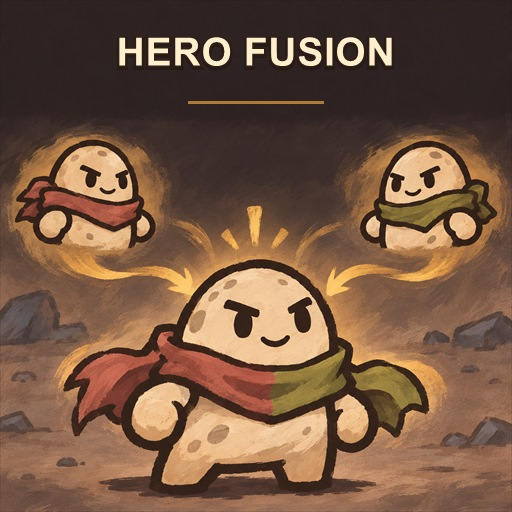

# BrotatoMod-HeroEditor

在 Brotato 1.2.0.1 的角色选择界面增加 **Hero Editor**。选择两个已解锁角色后，将它们临时合成为本局角色；不会向游戏角色列表或进度中添加永久角色。

## 合成规则

- 合并双方的全部效果。数值属性修正相加，正负值也会抵消，例如生命值 `+10` 与 `-5` 合为 `+5`。
- 其他技能和负面效果全部保留。
- 合并双方的起始武器、起始道具、偏好标签和禁用列表，并去掉重复项。
- 起始武器仍通过游戏原有的开局武器选择流程选择。
- 合成角色可以直接选择全部难度。
- 来源角色必须已解锁，且其所需内容集必须处于启用状态。
- 合成界面并排预览角色 1（红色）和角色 2（绿色），下方蓝色区域显示合成角色。卡片下方只显示被动效果，使用较小字号；弹窗随视口放大，窄窗口会将两名来源角色改为上下排列。较长的被动说明可在卡片内滚动查看，窄屏内容也可滚动。

## 打包

ZIP 根目录应直接包含 `mods-unpacked/BrotatoMod-HeroEditor/`。
